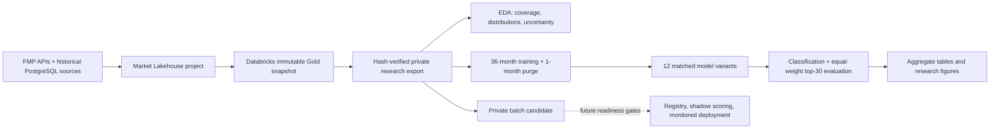
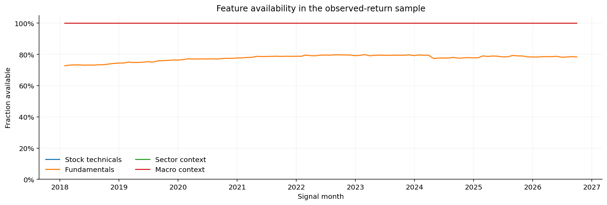
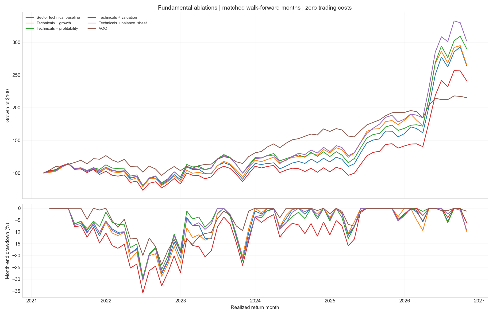
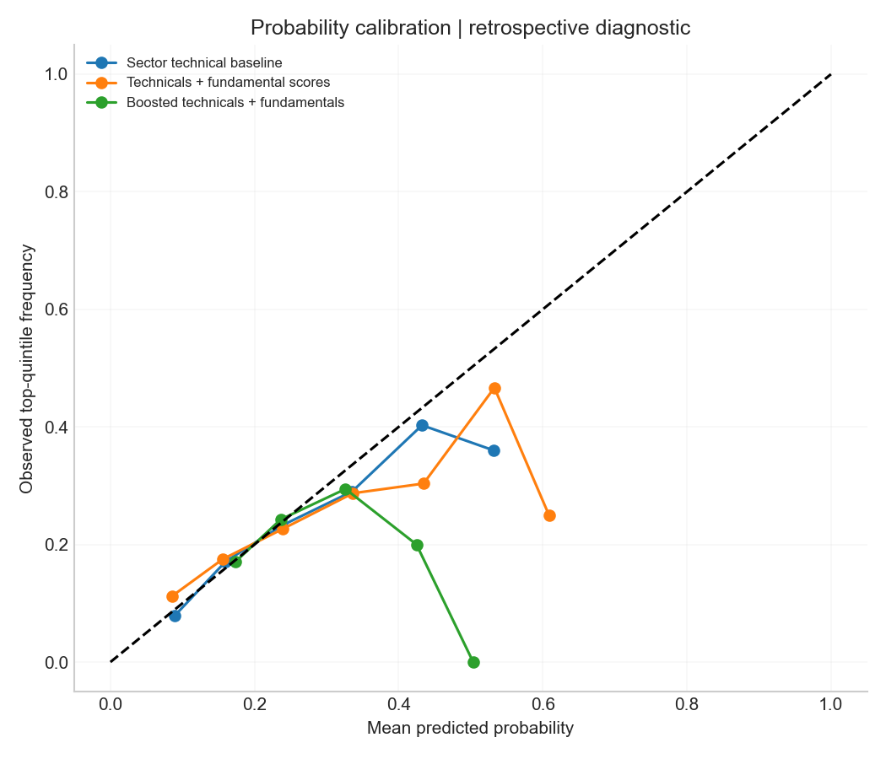

# S&P 500 ML

**WORK IN PROGRESS · Research portfolio · Local deployment candidate**

[](https://github.com/andrewnapurano00/SP500-ML/actions/workflows/ci.yml)


A data-science project investigating whether technical, sector and financial-statement features can help rank S&P 500 stocks for the following month. It combines executive EDA, time-aware classification, matched feature-family experiments and portfolio evaluation, with a private batch-scoring candidate and a documented path toward deployment.

The companion [S&P 500 Market Lakehouse](https://github.com/andrewnapurano00/SP500-Market-Lakehouse) owns ingestion, PostgreSQL migration and governed Databricks data. **This repository owns the research and modeling layer.** It publishes code, aggregate historical results and figures. Market-data rows, security-level predictions, holdings, credentials and fitted estimators remain private.

> **Current conclusion:** Financial-strength features are a useful research hypothesis. Their apparent historical portfolio advantage is not statistically established. These results are development evidence; the project is not a live investment service or a production-approved model.

## Research question

Does adding sector-aware fundamental information improve next-month stock ranking relative to a technical-and-sector baseline, when the eligible universe, dates, training windows and portfolio rule are held constant?

The primary classifier predicts membership in the next month's top-return quintile. Beating VOO is a separately named secondary target. Probabilities measure those events; they are not expected returns. Historical membership and stable security identifiers are retained instead of substituting today's constituents throughout history.

## Architecture



Gold is the source of truth. The export adapter reads explicit Delta versions and records the immutable source-binding hash. There is no PostgreSQL fallback in this package. EDA and training consume private, checksummed exports; checked-in results are a dated snapshot rather than an automatically updating dashboard. See [methodology](docs/METHODOLOGY.md).

## Data and experiment scope

| Item | Scope |
| --- | --- |
| Gold panel | 53,423 stock-month rows; 106 signal months |
| Mature research sample | 52,421 stock-months; 105 signal months, January 2018–September 2026 |
| Latest feature-only signal | October 30, 2026; unknown next-month outcomes retained |
| Declared lakehouse predictors | 215, plus 35 applicability/status flags |
| Fundamental families | Growth, profitability, valuation, balance sheet |
| Evaluation | 68 return months, March 2021–October 2026 |
| Outer training | Rolling 36 months, followed by one purged month |
| Models | 12 variants; logistic regression and constrained gradient boosting |
| Research portfolio | Equal-weight top 30; zero trading costs |
| Benchmark | VOO over the same return months |

The 215 warehouse predictors are not every estimator's input width: the financial-strength specification uses 74 transformed inputs. Reversal duplicates are omitted from inferential screening and model design. Missing fundamentals do not trigger a complete-case universe filter.

## EDA findings

The EDA examines population coverage, return distributions, missingness/applicability, technical and financial signals, context, redundancy and stability. Tests use 5,000 paired circular block resamples of three consecutive months, with six-month sensitivity and joint Benjamini–Hochberg correction; dependence-conservative Benjamini–Yekutieli results are also exported.

- Monthly stock returns averaged **0.99%**, with **9.62%** standard deviation. The middle 90% ranged from **−13.44% to +15.74%**; observed tails remain in the analysis.
- **20.05%** of stock-months were labeled top quintile; **47.64%** beat VOO. Accuracy alone would be misleading for the primary imbalanced target.
- **183 feature screens / 262 estimable endpoint tests** produced **zero discoveries at adjusted q < 0.05**. Descriptive leaders are hypotheses, not validated trading signals.
- Trend fit had mean monthly rank association approximately **0.025** and a **0.51 percentage-point** top-minus-bottom quintile spread; adjusted q was **0.296**. Its association weakened in the later period.
- Average observed coverage of applicable financial-factor sector scores was **92.9%**. Structural exclusions and observed-value flags are analyzed separately.
- Correlated momentum/trend inputs and unstable factor associations motivate training-only regularization, redundancy checks and regime analysis.



[Detailed EDA interpretation](docs/EDA_RESULTS.md) · [Feature tests](results/eda/feature_tests.csv) · [Annual stability](results/eda/annual_signal_stability.csv)

## Historical model results

All figures below use the same **68 return months**, eligible monthly universe and **zero-cost, equal-weight top-30 research policy**. They do not describe the separate frozen model's capped deployment allocations.

| Strategy | Cumulative return | Annualized return | Annualized volatility | Maximum drawdown | Mean monthly top-quintile AUC | Brier score |
| --- | ---: | ---: | ---: | ---: | ---: | ---: |
| Technicals + balance sheet | 202.28% | 21.56% | 27.35% | −30.33% | 0.5776 | 0.1585 |
| Sector technical baseline | 164.49% | 18.72% | 28.73% | −29.96% | 0.5814 | 0.1582 |
| VOO | 115.37% | 14.50% | 15.14% | −23.90% | — | — |

The financial-strength portfolio had the highest historical return among these three, while the technical baseline had slightly better classification discrimination and calibration. Both stock-selection portfolios had materially higher volatility and drawdown than VOO. Return ranking and probability quality answer different questions.

Financial strength's mean monthly return difference versus the technical baseline was **+0.17 percentage points**, with 95% block-bootstrap interval **[−0.16, +0.50] percentage points** and p = **0.313**. Versus VOO it was **+0.71 percentage points**, interval **[−0.81, +1.98]**, p = **0.298**. Both had BH q approximately **0.683** across strategy comparisons. **Neither establishes an advantage.**




[All model results](results/models/performance_summary.csv) · [Paired tests](results/models/paired_return_tests.csv) · [Annual returns, including partial years](results/models/calendar_year_returns.csv) · [Interpretation and failed controls](docs/MODEL_RESULTS.md)

## Data-science skills demonstrated

| Skill | Concrete evidence |
| --- | --- |
| Problem formulation | Distinct classification targets and portfolio objectives; explicit timing, cohort and benchmark |
| Data preparation | Stable-ID joins, changing historical membership, label maturity, missingness and applicability contracts |
| Exploratory analysis | Coverage and tails, imbalance, appropriate sector/market grains, redundancy and temporal stability |
| Feature engineering | Cross-sectional ranks, sector context, financial ratios/composites and quality flags |
| Statistical inference | Paired block bootstrap, uncertainty intervals, multiplicity correction and sensitivity analysis |
| Temporal ML validation | Purged rolling windows, training-only scaling and nested boosting-round validation |
| Modeling and diagnostics | Regularized logistic regression, constrained XGBoost, family ablations, AUC/PR, log loss, Brier and calibration |
| Financial evaluation | Matched VOO comparisons, portfolio accounting, volatility, drawdown and partial-year disclosure |
| Reproducible engineering | Source/data hashes, seeds, persistence checks, synthetic tests and CI |
| Critical interpretation | Null results, revision uncertainty, reused history and unresolved numerical sensitivity |
| Deployment preparation | Private batch candidate, artifact/feature checks and complete-cohort scoring; monitoring/rollback roadmap |

See [skills and evidence](docs/SKILLS.md) for demonstrated work versus planned work.

## Run locally

Python 3.11 or 3.12. Installation and tests need no vendor API key or private dataset:

```bash
python -m venv .venv
# Activate .venv using your shell's activation command.
python -m pip install -e ".[test,notebook]"
python -m pytest -q
python -m sp500_ml.cli --help
```

To reproduce research, supply your own authorized Databricks Gold access. Authenticate through the SDK profile mechanism; keep credentials outside this repository:

```bash
python -m pip install -e ".[lakehouse]"
sp500-ml export-gold --binding data/binding.json --profile YOUR_PROFILE --warehouse YOUR_WAREHOUSE --output data/prepared
sp500-ml eda --input data/prepared --output outputs/eda
sp500-ml model --input data/prepared --output outputs/models
```

The binding comes from the companion lakehouse's verified snapshot registry and must pin feature/cohort/target table versions. Inputs include contiguous mature history and a latest feature-only cohort. The alternative `prepare` command accepts a private export plus provenance JSON; see [reproduction](docs/REPRODUCING.md).

Reruns can be expensive and write private per-security outputs into ignored directories. This package is a portable extraction of the original workflow. Historical metrics come from the original validated run, **not a newly certified full retraining of this extracted package**. Library and numerical differences can change selections.

Open [Research.ipynb](notebooks/Research.ipynb) and [Model_Results.ipynb](notebooks/Model_Results.ipynb) to review aggregate evidence without downloading data or training models.

## Deployment status and next steps

| Area | Current status | Next gate |
| --- | --- | --- |
| Lakehouse integration | Implemented in source project; explicit Gold adapter here | Operator access, binding and freshness verification |
| Historical EDA/modeling | Original run validated; aggregates published | Unseen evaluation and standalone full-rerun parity |
| Private batch candidate | Implemented; synthetic train/reload/score tests | Actual-Gold artifact acceptance and parity |
| Frozen M03 workflow | Separate local workflow, unchanged | Explicit artifact/policy parity before replacement |
| Container / hosted inference | Planned | Platform selection, lock, secrets and deployment target |
| Registry / shadow / monitoring | Planned | Registry, shadow acceptance, alerts and rollback rehearsal |
| Live trading / broker integration | Not implemented | Separate scope and operational approval |

**Feature improvements:** filing-vintage verification, financial-sector applicability, value-versus-status ablation, training-only redundancy/regularization, calibration and solver stability. Verify delisting/return semantics, execution timing and turnover. Reserve future dates for confirmation.

**Deployment path:** reproducible artifact → actual-data parity and quality gates → private batch/shadow scoring → monitored paper operation → explicit production decision. See [roadmap](docs/ROADMAP.md) and [deployment guide](docs/DEPLOYMENT.md).

## Repository structure

```text
src/sp500_ml/       Data contract, EDA, rolling experiments, evaluation, batch candidate, CLI
notebooks/         Aggregate EDA and model-result review
results/           Dated aggregate tables and provenance hashes
docs/figures/      Aggregate research figures
docs/              Methodology, findings, skills, deployment and roadmap
tests/             Synthetic temporal, preprocessing and candidate checks
.github/workflows/ Offline CI and publication checks
```

## Limitations and provenance

Vendor financials may be revised and classifications retrospective; original-filing-vintage certification is outstanding. Inspected history is not an untouched holdout. Same-close execution is unproven. Unknown selected holding outcomes must never be zero-filled, dropped or reweighted when reporting realized performance.

Lakehouse reconciliation corrected known-return vintage mixing and retained 53 intentional top-quintile label differences from full-population ranking. An original-label technical control reproduced exactly, but a balance-sheet refit changed two selection flags after tiny tensor differences. Exact selection parity remains unresolved; see [model results](docs/MODEL_RESULTS.md).

Snapshot `refresh_target_basis_v2_20261108`, recorded as of `2026-11-09T00:59:59Z` (November 8 in New York). [Provenance](results/provenance.json) records original source hashes, versions and public table checksums. No model was promoted by this publication.
