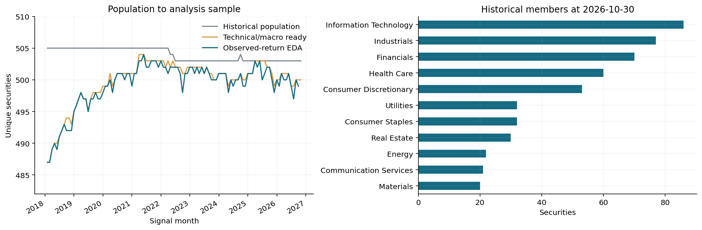
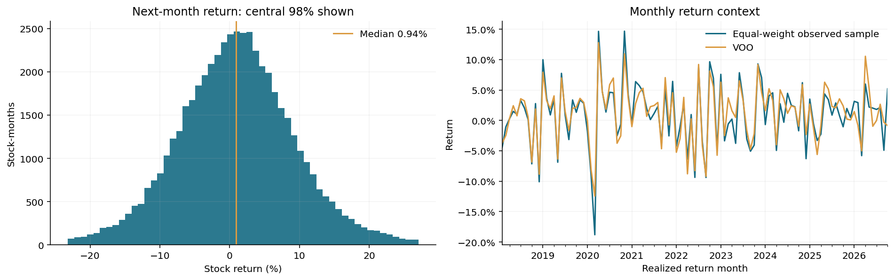
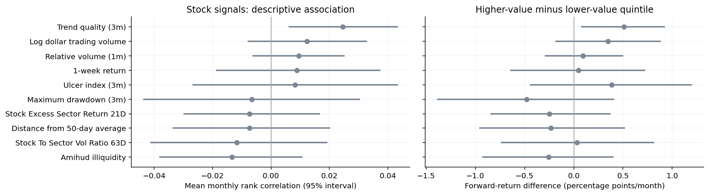
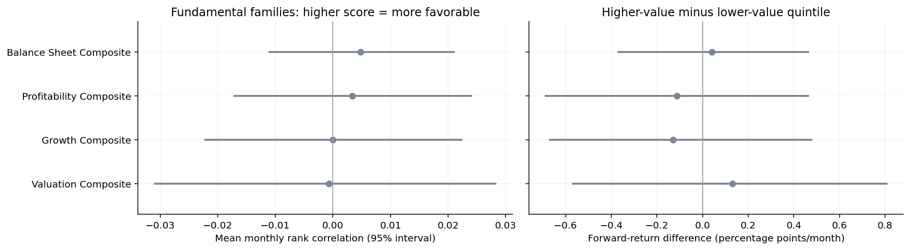
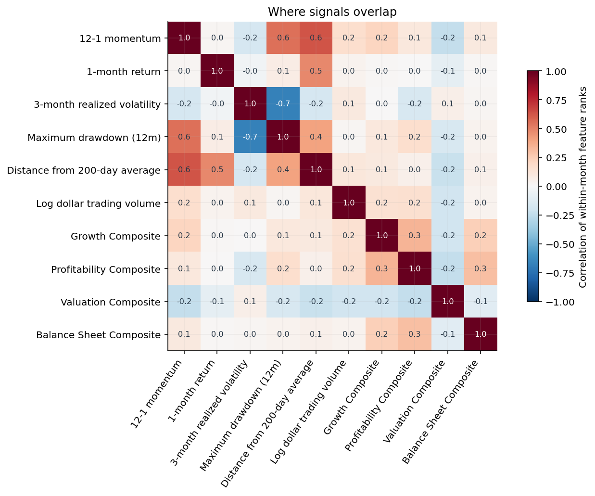
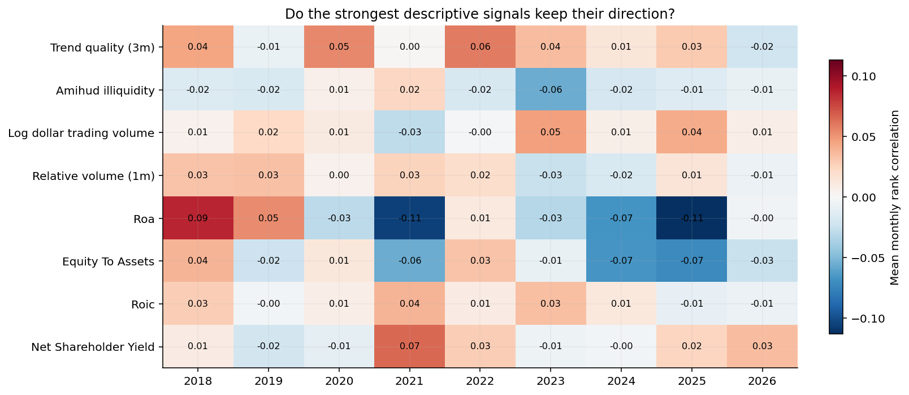

# EDA results and interpretation

**WORK IN PROGRESS · 52,421 stock-months · 105 signal months.** Figures and tables describe the corrected lakehouse-aligned snapshot.

## Distribution and coverage

Mean monthly stock return is0.99%, median0.94%, standard deviation9.62%. The middle90% spans−13.44% to+15.74%; extremes−99.84% and+214.16% remain in statistics. Positive returns occur in 54.57% of rows, VOO outperformance in 47.64% and top-quintile labels in 20.05%.

Applicable financial-score coverage averages 92.9%. Structural inapplicability differs from a source failure. The current two-factor minimum prevents financial companies from receiving the balance-sheet composite, although equity/assets remains available. A sector-appropriate policy needs a separate matched experiment.

## Signal and uncertainty

Across 183 features and262 estimable endpoint tests, zero association and zero quintile-spread discoveries survive joint BH q<0.05. Pointwise intervals excluding zero do not overturn the adjusted result.

Trend R-squared has monthly rank association approximately 0.025, pointwise interval[0.006,0.043], and Q 5−Q 1 spread0.51 percentage points/month, interval[0.081,0.920]. Adjusted q 0.296. Association weakens from 0.031 before 2024 to0.010 thereafter. Balance-sheet composite association is0.005 and spread0.04 percentage points/month, without adjusted significance.

Profitability association shifts from +0.013 to−0.017 across early/later periods; ROIC shifts from +0.019 to−0.001. These are descriptive stability checks, not rules selected on an untouched period.

## Context and redundancy

VIX monthly association is0.251, pointwise interval[0.081,0.422], adjusted q 0.251. This does not validate timing. Sector-volatility spread is0.93 percentage points/month, adjusted q 0.303. Repeated context observations require the correct inference grain.

Momentum12−1 and200-day distance correlate0.63; realized volatility and maximum drawdown correlate−0.68. Overlap motivates training-only pruning and regularization, not deletion based on all inspected dates.

Next test sector applicability, values versus status flags, vendor vintages and unseen-period stability. Univariate EDA does not establish causality, independent information or multivariable portfolio benefit.
