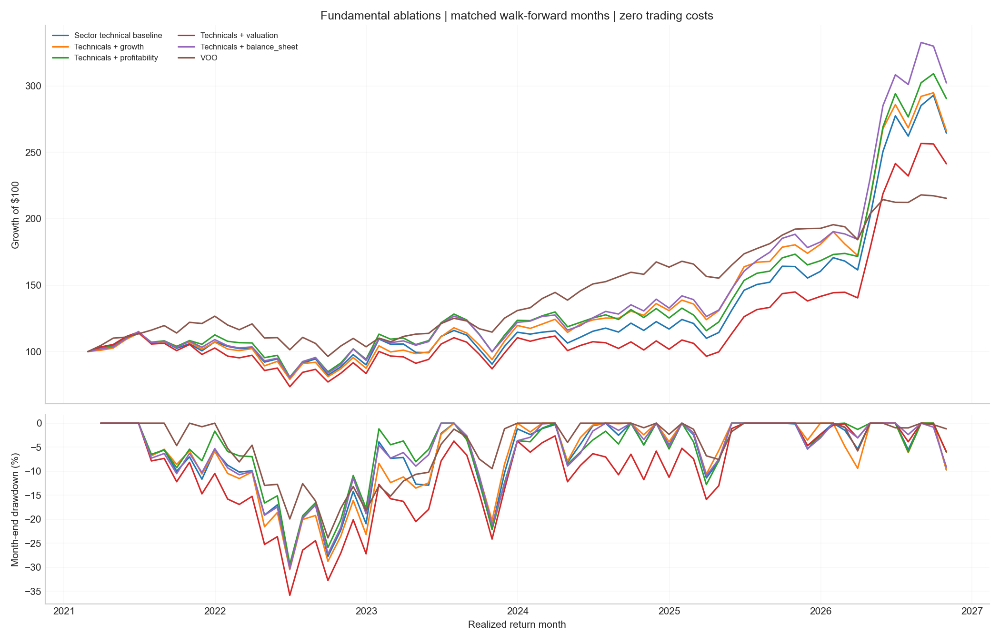
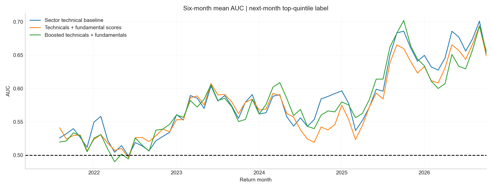

# Model results and controls

**WORK IN PROGRESS · March2021–October2026 return months ·68 paired months.** Headline metrics use `results/models/performance_summary.csv`. Mean monthly AUC is not pooled AUC; do not mix this scope with the older66-month report.

Financial strength returned 202.28% cumulatively versus 164.49% for technical/sector baseline and115.37% for VOO, before costs. Its volatility 27.35% and drawdown −30.33% show substantially greater risk than VOO. Technical baseline AUC 0.5814/Brier 0.1582 were slightly better than strength AUC 0.5776/Brier 0.1585. Return and classification rankings differ.

Strength minus technicals: mean monthly difference+0.1706 percentage points, pointwise95% interval[−0.1639,+0.5049], p 0.313. Strength minus VOO:+0.7085, interval[−0.8102,+1.9816], p 0.298. BH q≈0.683 and BY q 1 for both. Neither establishes an advantage. All variants, including weaker fundamental-only and boosted models, remain in the tables.

## Data reconciliation

Historical features/context and known returns reconciled with validated research keys within tolerance. There are53 intentional label differences: top-quintile ranking now uses full retained membership rather than an outcome-conditioned subset.

A rerun exposed mixed adjusted-price vintages in recomputed known outcomes:462 stock-month returns and22 benchmark months differed. The corrected target basis anchors known returns to validated history while allowing unknown outcomes to mature. Two superseded candidates were quarantined from activation. This correction is not an economic improvement attributable to a factor.

## Numerical sensitivity

An original-label control reproduced technical baseline selections/returns exactly. The balance-sheet control changed two security-month selection flags in one signal month, January2024, despite tensor differences at most2.6645e−15. Probability differences reached0.0017274. Exact refit parity therefore did not pass. Solver, ordering, environment and convergence sensitivity must be investigated before promotion. A fixed seed alone does not guarantee identical selections.

Inspected history, vendor revisions, retrospective classifications, applicability, delistings, same-close execution and turnover limit interpretation. Unknown selected outcomes cannot be dropped, zero-filled or reweighted. The existing frozen M03 artifact is unchanged; this package's new batch candidate is not certified as an exact replacement. Locked prospective evidence is the next decisive test.
